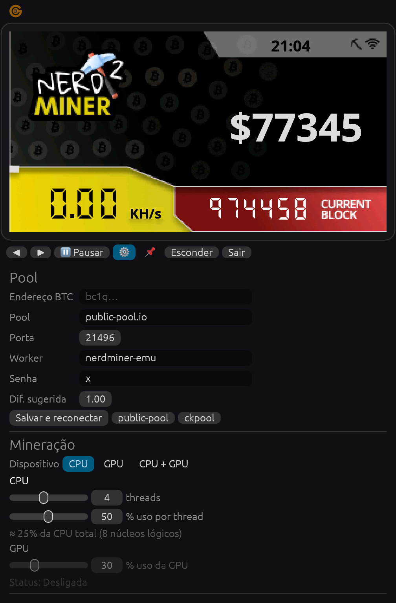
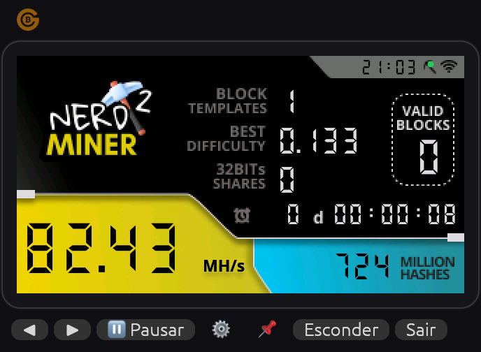
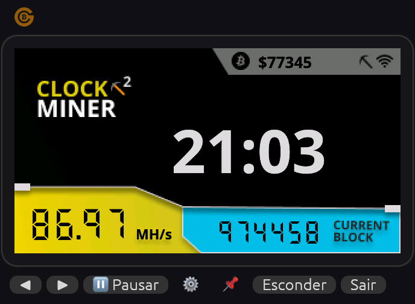
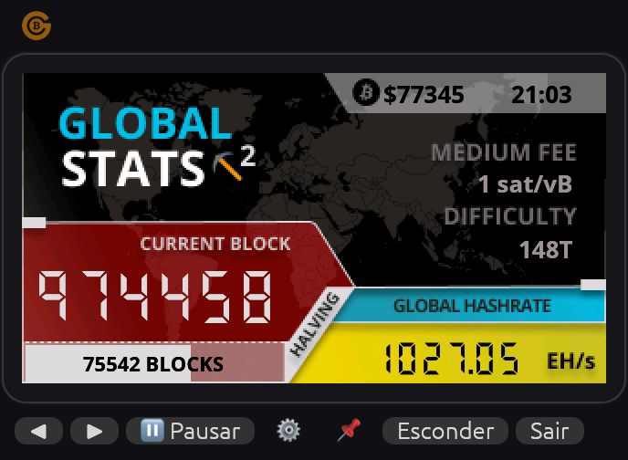
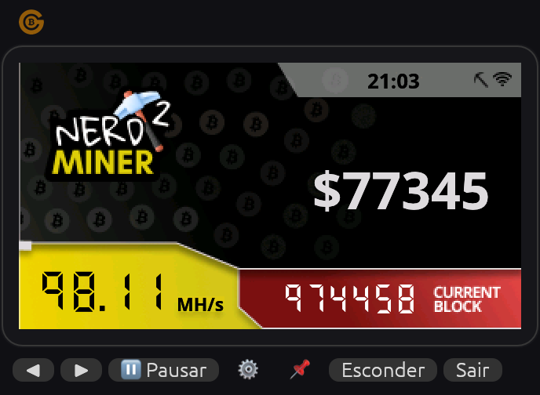

# NerdMiner Emulator: User Manual

**English** | [Português (BR)](MANUAL.pt-BR.md)

This manual explains how to set up the emulator, what every screen and setting does, and how it
works under the hood. For installation see the [README](../README.md#install).

> The app speaks **English and Portuguese** and follows your system language by default (change it
> in ⚙ → Window → **Language**, or in the tray's **Language ▸**). This manual was written with the
> Portuguese labels, each followed by its English text, e.g. **Salvar e reconectar** (Save and reconnect).

- [1. What it is (and what to expect)](#1-what-it-is-and-what-to-expect)
- [2. Quick start](#2-quick-start)
- [3. The window](#3-the-window)
- [4. The screens](#4-the-screens)
- [5. Settings (⚙)](#5-settings-)
- [6. System tray](#6-system-tray)
- [7. How it works](#7-how-it-works)
- [8. Following your miner on the pool](#8-following-your-miner-on-the-pool)
- [9. Start automatically at login](#9-start-automatically-at-login)
- [10. Configuration file](#10-configuration-file)
- [11. Troubleshooting](#11-troubleshooting)

---

## 1. What it is (and what to expect)

The NerdMiner Emulator is the desktop version of the [NerdMiner](https://github.com/BitMaker-hub/NerdMiner_v2),
the small ESP32 device that does **solo Bitcoin mining**. It connects to a **solo pool**, receives
block templates and keeps hashing them. If one of its hashes is good enough to be a valid block,
**the whole block reward goes to your address**.

That is a lottery with very long odds. The expected time to find a block is roughly:

```
time ≈ network difficulty × 2³² ÷ your hashrate
```

With a network difficulty of ~148 T and 80 MH/s (CPU + GPU of an M1), that is about
**250 million years** on average. It can happen on any hash, but it almost certainly won't. Run
it for fun, to learn how mining works, and as a "lottery ticket" that costs only a bit of
electricity. Don't expect income.

What you **don't** need:

- No private keys or wallet: you only enter a **receiving address**.
- No UPnP or port forwarding: the app only makes outbound connections.
- No account on the pool: on solo pools your address *is* your login.

## 2. Quick start

1. Install and open the app (see the [README](../README.md#install)).
2. On first launch the settings panel opens automatically:

   

3. Paste your **Bitcoin address** into **Endereço BTC** (BTC address).
4. Leave the pool as `public-pool.io` / `21496` (the NerdMiner default) or click **ckpool** to use
   `solo.ckpool.org` / `3333`.
5. Click **Salvar e reconectar** (save and reconnect).
6. Within a few seconds the dot next to the wifi icon on the **Miner** screen turns **green**, and
   **Block templates** starts counting. You're mining.
7. Adjust how much CPU/GPU to use under **Mineração** (mining). It applies immediately.
8. Click **⚙** again to close the panel, or **Esconder** (hide) to send the app to the tray.

## 3. The window



| Element | What it does |
|---|---|
| Go BTC logo (top-left) | Opens https://gobtc.com.br in your browser. |
| Top strip | Drag it to move the window. |
| Screen | **Click** to go to the next screen (like the device button). **Drag** to move the window. |
| **◀ / ▶** | Previous / next screen. |
| **⏸ Pausar** / **▶ Minerar** | Pause / resume mining (CPU and GPU). The state is remembered: if you quit while paused, the app starts paused next time. |
| **⚙** | Opens/closes the settings panel. |
| **📌** | Keep the window always on top of other windows. |
| **Esconder** (hide) | Hides the window in the system tray (only shown if a tray is available). |
| **Sair** (quit) | Saves the settings and quits. |

The window has no title bar on purpose, so it looks like the device sitting on your desktop. Use
the zoom setting (section 5) to change its size.

## 4. The screens

For the first 3 seconds the NerdMiner boot screen is shown. Then you can cycle through 4 screens,
the same as the T-Display version of the firmware. Statistics start from zero each time the app
starts. Network data (price, block height, fees…) comes from mempool.space and is refreshed every
60 seconds.

### Miner


| Field | Meaning |
|---|---|
| Clock (top bar) | Local time. |
| Dot next to the wifi icon | **Green** = connected and authorized on the pool. **Red** = not connected (see [Troubleshooting](#11-troubleshooting)). |
| **Block templates** | How many jobs (`mining.notify`) the pool has sent. Each new Bitcoin block or template update increments it. If it doesn't grow, you're not receiving work. |
| **Best difficulty** | The highest difficulty among all hashes found since the app started. It's the "closest you got" to a block. |
| **32BITs shares** | Hashes whose 32 most significant bits are zero (difficulty ≥ 1). It's the classic NerdMiner statistic. |
| **Valid blocks** | Hashes that met the network difficulty, i.e. real blocks found. |
| ⏰ `0 d 00:00:08` | Time since the app started (days, then hh:mm:ss). |
| Big number (yellow) | Current hashrate (CPU + GPU). The unit changes automatically: KH/s, MH/s or GH/s. While paused it shows **PAUSADO** (paused). |
| **Million hashes** (blue) | Total hashes computed, in millions. |

### Clock



Large clock, BTC price in your currency (top), your hashrate (yellow) and the current block height (blue).

### Global stats



| Field | Meaning |
|---|---|
| Price and time | BTC price in your currency and local time. |
| **Medium fee** | Fee to be confirmed within ~30 minutes (sat/vB). |
| **Difficulty** | Current Bitcoin network difficulty (e.g. `148T`). |
| **Current block** | Current block height. |
| **Halving** bar | Progress of the current halving period, with the number of blocks remaining until the next halving. |
| **Global hashrate** | Total network hashrate in EH/s. |

### BTC price



Large BTC price in your currency (USD shows `$` like the device; e.g. `R$430459`, `€69608`), local time, your hashrate and the current block height.

## 5. Settings (⚙)

Changes in the **Mineração** (mining) and **Janela** (window) sections apply **immediately** and
are saved automatically. Changes in the **Pool** section only apply after you click
**Salvar e reconectar** (save and reconnect).

### Pool

| Field | Description |
|---|---|
| **Endereço BTC** (BTC address) | Address that receives the reward if you find a block. Use an address **from a wallet you control** (bc1q…, bc1p…, 3… or 1…). Avoid exchange deposit addresses: block rewards are special transactions that only become spendable after 100 confirmations, and exchanges may not credit them. |
| **Pool** | Pool host. Default `public-pool.io`. |
| **Porta** (port) | Pool port. `21496` for public-pool.io, `3333` for solo.ckpool.org. |
| **Worker** | Name of this miner. It's sent as `address.worker`, which lets you tell several machines apart on the pool. Leave it empty to send only the address. |
| **Senha** (password) | Stratum password. Solo pools ignore it; leave `x`. |
| **Dif. sugerida** (suggested difficulty) | Share difficulty requested from the pool via `mining.suggest_difficulty`. `0` = don't ask. See below. |
| **Salvar e reconectar** | Saves the pool fields and reconnects immediately. |
| **public-pool** / **ckpool** | Fill in host and port for these pools. You still need to click **Salvar e reconectar**. |

**About the suggested difficulty.** A *share* is a hash good enough for the pool's difficulty
(not the network's). Shares prove to the pool that you're working, and they're what the pool
dashboard counts. Lower difficulty means more shares, so you see activity more often, but more
messages are sent too. A rough guide:

```
seconds per share ≈ difficulty × 4.3 billion ÷ hashrate
```

At 80 MH/s, difficulty `1` gives about one share per minute, which is the default. Shares don't
change your chance of finding a block. The pool may ignore the suggestion and impose its own
difficulty; the value in use appears in the log.

### Mineração (mining)

| Control | Description |
|---|---|
| **Dispositivo** (device) | Choose **CPU**, **GPU** or **CPU + GPU**. Controls for the unused device are greyed out. |
| **threads** (CPU) | How many CPU threads mine (1 up to the number of logical cores). |
| **% uso por thread** (% per thread) | Fraction of time each thread works. 50% = works half the time, rests the other half. |
| Total estimate | `≈ X% da CPU total` shows the expected share of your whole CPU: `threads × % ÷ cores`. |
| **% uso da GPU** (GPU %) | Fraction of time the GPU is kept busy. |
| GPU status | `Desligada` (off), `Inicializando…` (starting), `Minerando — <GPU>` (mining), `Aguardando trabalho` (waiting for work), `Pausada` (paused) or `Indisponível: <reason>` (unavailable). |

Suggested profiles:

| Profile | Setting | Effect |
|---|---|---|
| Silent / laptop on battery | CPU, 1 thread @ 10–25% | Almost unnoticeable. |
| Balanced (default) | CPU, half the threads @ 50% | ~25% of the CPU, fans usually quiet. |
| GPU only | GPU @ 30% | Barely uses the CPU; the desktop stays smooth. |
| Maximum | CPU + GPU, all threads @ 100%, GPU @ 100% | Highest hashrate, more heat and noise. Avoid on battery. |

Mining at high usage for long periods produces heat. Laptops may throttle or get loud.

### Janela (window)

| Option | Description |
|---|---|
| **Iniciar escondido na bandeja** (start hidden in tray) | The app starts in the tray, without showing the window. Useful together with starting at login. |
| **Zoom da tela** (screen zoom) | Screen size: 1x (320×170, like the device), 1.5x, 2x or 2.5x. |
| **Moeda** (currency) | Currency for the BTC price (screens and tray) and fee costs: BRL, USD, EUR, GBP, CAD, CHF, AUD or JPY. Default: from the system language/region (Portuguese → BRL). Also in the tray: *Moeda ▸*. |
| **Idioma** (language) | Interface language: Automatic (system), Português (Brasil) or English. Applies immediately, including the tray menu. Also in the tray: *Idioma ▸*. |

### Log

Shows the latest events: connection, authorization, pool difficulty, shares sent/accepted/rejected,
new best difficulty and errors. It's the first place to look when something isn't working.

## 6. System tray

The app adds an icon to the system tray (menu bar on macOS, notification area on Windows,
StatusNotifier on Linux). It works as a small text dashboard, so you rarely need the window.

**Status dot** on the icon: 🟢 mining · 🟡 connecting · 🔴 no pool (missing address or error) ·
⚪ paused.

**Menu bar text (macOS only).** Next to the icon, the fields you tick in *Barra de menus mostra*
(menu bar shows). Default: hashrate + recommended fee, e.g. ` 82.4 MH/s · ⛽🟢 1 sat/vB`.

| Field | Example | Meaning |
|---|---|---|
| Hashrate | `82.4 MH/s` | your current hashrate (`Pausado` when paused) |
| Recommended fee | `⛽🟢 1 sat/vB` | fee to use right now; the dot is the network occupancy |
| Last block | `⛓ 4m` | minutes since the last block on the network |
| Best difficulty | `★ 0.133` | best share of this session |
| Price | `R$ 430k` | BTC price in the chosen currency |

On **Windows and Linux** the tray can't show text: hover the icon for a tooltip with the same
summary, and double-click it to show/hide the window.

**The menu** (all lines refresh every second while open):

```
● Minerando — public-pool.io · 3 h 12
Hashrate   82.4 MH/s   (CPU 26.1 MH/s · GPU 56.3 MH/s)
Melhor dificuldade   0.133
Shares   12 (32 bits) · aceitas 3 · blocos 0
Chance hoje   1 em 92,2 bi · bloco a cada ~252 mi anos
─────
Bloco   #974.516 · AntPool · há 2 min
Ajuste de dificuldade   39% · −2,66% em ~8,8 dias (1.228 blocos)
BTC   R$ 430.462
─────
REDE BITCOIN   🟢 Livre
Fila pagante   ▕███░░░░░░░░░░░░░▏ 0,84 bloco · ~10 min para limpar
Mempool   47,3 mil tx · 11,4 vMB (maioria abaixo de 1 sat/vB)
Próximo bloco   0,12 – 137 sat/vB · mediana 1,3 · 4,3 mil tx
TAXA PARA ENVIAR AGORA   (Simples 1→2, SegWit · 141 vB)
🚀 Próximo bloco (~10 min)   2 sat/vB · 282 sats ≈ R$ 1,21
⏱ ~30 min   1 sat/vB · 141 sats ≈ R$ 0,61
🕐 ~1 hora   1 sat/vB · 141 sats ≈ R$ 0,61
🐢 Sem pressa   1 sat/vB · 141 sats ≈ R$ 0,61
✅ Recomendado: 1 sat/vB — rede livre, não pague mais
─────
Dispositivo ▸ · Uso da CPU ▸ · Uso da GPU ▸ · Tamanho da transação ▸ · Barra de menus mostra ▸
Pausar mineração · Ver na pool… · Ver no mempool.space… · Ocultar janela · Sair
```

**Network occupancy.** The total mempool size is misleading (most of it can be transactions paying
less than the minimum fee, which don't compete for space). The app counts only the transactions
paying at least the minimum recommended fee and expresses that queue in blocks (1 block = 1 MvB,
~10 min):

| Level | Paying queue | Recommended tier |
|---|---|---|
| 🟢 Livre (free) | ≤ 1 block | *Sem pressa* (no rush): paying more doesn't help |
| 🟡 Moderada (moderate) | 1–6 blocks (~1 h) | *~30 min* |
| 🟠 Congestionada (congested) | 6–36 blocks (~6 h) | *~1 hora*, low fees may take hours |
| 🔴 Muito congestionada (severe) | > 36 blocks | *~1 hora*, send only if urgent |

**Cost of sending** = fee rate × transaction size, shown in sats and in your currency (*Moeda ▸*). Pick the size in
*Tamanho da transação*: simple SegWit 1→2 (141 vB, default), Taproot 1→2 (154 vB) or a 5→1
consolidation (382 vB).

**Quick controls** (applied immediately and saved): *Dispositivo* (CPU / GPU / CPU + GPU),
*Uso da CPU* (10–100 % per thread), *Uso da GPU* (10–100 %). *Ver na pool…* opens your stats page on
public-pool.io or solo.ckpool.org; *Ver no mempool.space…* opens the latest block.

Data sources: mempool.space (blocks, mempool, fees, difficulty; price in USD, EUR, GBP, CAD,
CHF, AUD, JPY) and Coinbase, with Binance as a fallback, for BTC/BRL. Fees and mempool refresh every 30 s, the rest every 60 s.

While hidden, the app keeps mining normally.

## 7. How it works

```
 mempool.space ──HTTPS──► network data (screens)
                                                    ┌── CPU threads (SHA-256d)
 pool ◄──Stratum v1 (TCP)──► client ──► jobs ──────┤
       ◄── shares ─────────────────────────────────└── GPU (WGSL compute shader)
```

1. **Connection.** The client opens a TCP connection to the pool and sends `mining.subscribe`,
   `mining.suggest_difficulty` (if configured) and `mining.authorize` with `address.worker`.
2. **Jobs.** The pool sends `mining.notify` with the block template: previous block hash,
   coinbase transaction parts, merkle branches, version, `nbits` and time. Every new job increments
   **Block templates** and makes the miners restart on fresh work.
3. **Work units.** For each unit of work the app picks a unique *extranonce2*, builds the coinbase
   transaction (which pays the reward to your address), computes the merkle root and assembles the
   80-byte block header.
4. **Hashing.** Each CPU thread and the GPU try all 4.29 billion values of the header *nonce*,
   computing `SHA-256(SHA-256(header))`. The first 64 bytes of the header are hashed only once (the
   *midstate*), which speeds things up. On CPUs with SHA instructions (Apple Silicon, recent
   Intel/AMD) those are used.
5. **Checking.** A hash's difficulty is how far below the maximum target it is. Every result is
   checked against three thresholds:
   - ≥ 1 → counts as a **32-bit share**;
   - ≥ pool difficulty → sent to the pool as a **share** (`mining.submit`);
   - ≥ network difficulty → **valid block**: the pool broadcasts it and the reward goes to your address.
6. **Usage limits.** CPU threads hash in small chunks and, after each one, sleep in proportion to
   the configured percentage (duty cycle). The GPU works the same way: each dispatch takes about
   30 ms, followed by a proportional pause. That's why changing the sliders takes effect instantly.
7. **Resilience.** If the connection drops, the app reconnects after a few seconds. If the pool
   sends nothing for 5 minutes, it reconnects. Shares for an outdated job are discarded.

## 8. Following your miner on the pool

Solo pools show your statistics by address:

- public-pool.io: `https://web.public-pool.io/#/app/<your-address>`
- solo.ckpool.org: `https://solo.ckpool.org/users/<your-address>`

Each worker name appears separately, which helps when you run the emulator on several machines.
The pool's reported hashrate is an estimate based on shares, so it fluctuates more than the
number on the screen.

## 9. Start automatically at login

Turn on **Iniciar escondido na bandeja** (start hidden) so the app starts straight in the tray, then:

- **macOS**: System Settings → General → Login Items → **+** → choose *NerdMiner Emulator*.
- **Windows**: press `Win + R`, type `shell:startup`, and place a shortcut to `nerdminer-emu.exe`
  in that folder.
- **Linux**: create `~/.config/autostart/nerdminer-emu.desktop`:

  ```ini
  [Desktop Entry]
  Type=Application
  Name=NerdMiner Emulator
  Exec=/path/to/nerdminer-emu
  ```

## 10. Configuration file

Settings are saved as JSON:

- macOS: `~/Library/Application Support/nerdminer-emu/config.json`
- Linux: `~/.config/nerdminer-emu/config.json`
- Windows: `%APPDATA%\nerdminer-emu\config.json`

You can edit it with the app closed. Missing fields use their default values.

| Key | Default | Description |
|---|---|---|
| `btc_address` | `""` | Reward address. |
| `pool_host` | `"public-pool.io"` | Pool host. |
| `pool_port` | `21496` | Pool port. |
| `worker_name` | `"nerdminer-emu"` | Worker name (`address.worker`). |
| `pool_password` | `"x"` | Stratum password. |
| `suggest_diff` | `1.0` | Suggested share difficulty (`0` = don't send). |
| `cpu_enabled` | `true` | Mine with the CPU. |
| `cpu_threads` | half the cores | Number of CPU threads. |
| `cpu_usage` | `50` | % usage per thread (1–100). |
| `gpu_enabled` | `false` | Mine with the GPU. |
| `gpu_usage` | `30` | % GPU usage (1–100). |
| `always_on_top` | `false` | Window always on top. |
| `start_hidden` | `false` | Start hidden in the tray. |
| `start_paused` | `false` | Start paused (updated automatically by the pause button). |
| `zoom` | `1.5` | Screen zoom (1.0–2.5). |
| `tray_fields` | `["hashrate", "fee"]` | Menu bar fields (macOS): `hashrate`, `fee`, `last_block`, `best_diff`, `price`. |
| `tx_vbytes` | `141` | Transaction size used for the "cost of sending" estimate, in vB. |
| `currency` | from system language | `BRL`, `USD`, `EUR`, `GBP`, `CAD`, `CHF`, `AUD` or `JPY`. |
| `language` | `"auto"` | `"auto"` (system), `"pt-BR"` or `"en"`. |

To reset everything, quit the app and delete the file.

## 11. Troubleshooting

**The dot on the Miner screen is red / Block templates stays at 0**

- Check that **Endereço BTC** is filled in and that you clicked **Salvar e reconectar**.
- Open the log in ⚙. `connection timed out` almost always means the network is blocking the
  outbound port. Test it in a terminal:

  ```sh
  nc -vz public-pool.io 21496     # or: nc -vz solo.ckpool.org 3333
  ```

  If it times out, allow outbound TCP on that port in the firewall or try another network (a phone
  hotspot is a quick test). UPnP doesn't help: the connection is outbound.
- `autorização recusada` (authorization refused): the address is invalid for that pool.

**Hashrate stays at 0**

- Check that mining isn't paused (button **▶ Minerar**).
- Check that the selected device is enabled and that you're connected (green dot). Without a job
  from the pool there's nothing to hash.

**GPU shows "Indisponível" (unavailable)**

- The app needs Metal (macOS), Vulkan (Linux/Windows) or DirectX 12 (Windows). Update the graphics
  drivers. On Linux install the Vulkan drivers for your GPU (e.g. `mesa-vulkan-drivers`).
- After fixing it, restart the app; the GPU is only re-detected at startup.

**The computer got hot / loud**

- Lower **% uso por thread**, the number of threads, or switch to **GPU** at a low percentage.
  The change is instant.

**macOS says the app can't be opened**

- The app is not notarized by Apple. Right-click the app → **Open** → **Open**, or run
  `xattr -dr com.apple.quarantine "/Applications/NerdMiner Emulator.app"`.

**The tray icon doesn't appear (Linux)**

- On GNOME install the "AppIndicator and KStatusNotifierItem Support" extension. Without a tray the
  **Esconder** (hide) button isn't shown, so the window never hides with no way back.

**Clock/price/fees show `--`**

- That data comes from mempool.space over HTTPS. Check your internet connection; it refreshes every
  60 seconds. Mining doesn't depend on it.
