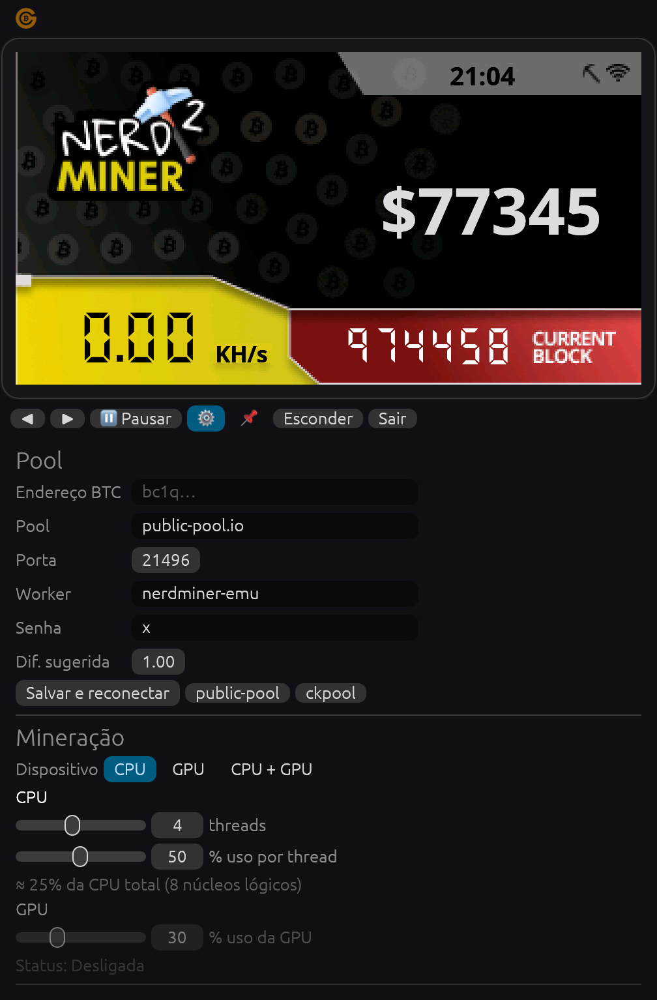
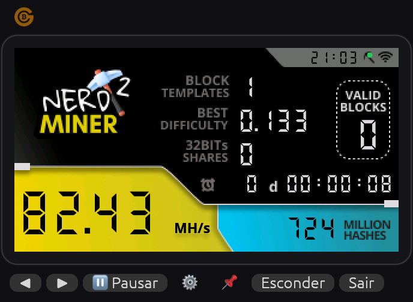
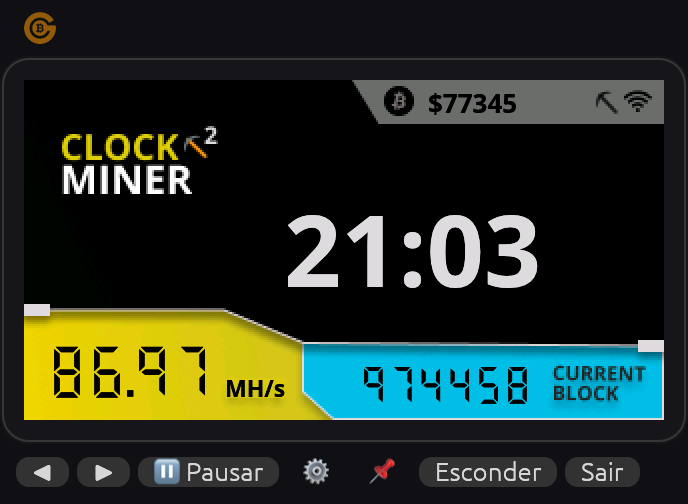
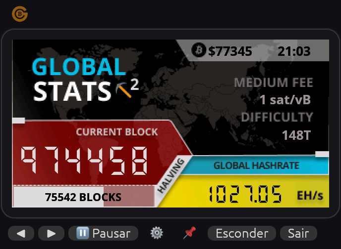
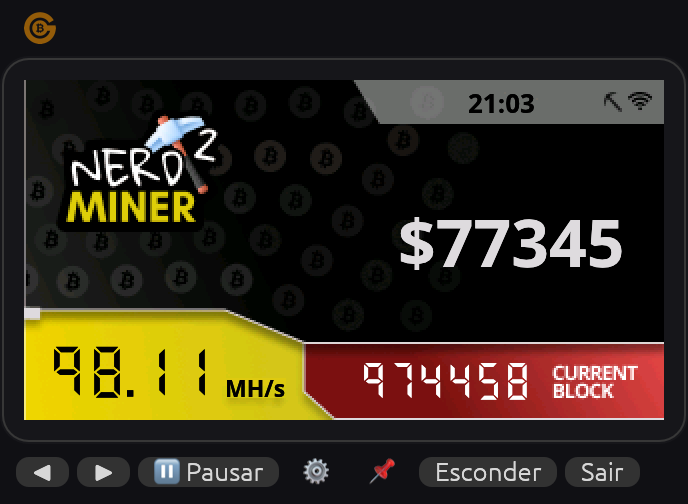

# NerdMiner Emulator: Manual do usuário

[English](MANUAL.md) | **Português (BR)**

Este manual explica como configurar o emulador, o que significa cada tela e cada opção, e como ele
funciona por dentro. Para instalar, veja o [README](../README.pt-BR.md#instalar).

- [1. O que é (e o que esperar)](#1-o-que-é-e-o-que-esperar)
- [2. Primeiros passos](#2-primeiros-passos)
- [3. A janela](#3-a-janela)
- [4. As telas](#4-as-telas)
- [5. Configurações (⚙)](#5-configurações-)
- [6. Bandeja do sistema](#6-bandeja-do-sistema)
- [7. Como funciona](#7-como-funciona)
- [8. Acompanhando na pool](#8-acompanhando-na-pool)
- [9. Iniciar junto com o sistema](#9-iniciar-junto-com-o-sistema)
- [10. Arquivo de configuração](#10-arquivo-de-configuração)
- [11. Solução de problemas](#11-solução-de-problemas)

---

## 1. O que é (e o que esperar)

O NerdMiner Emulator é a versão desktop do [NerdMiner](https://github.com/BitMaker-hub/NerdMiner_v2),
o pequeno aparelho com ESP32 que faz **mineração solo de Bitcoin**. Ele se conecta a uma
**pool solo**, recebe modelos de bloco e fica calculando hashes sobre eles. Se algum hash for bom o
bastante para ser um bloco válido, **a recompensa inteira do bloco vai para o seu endereço**.

É uma loteria com chances muito pequenas. O tempo médio para achar um bloco é, aproximadamente:

```
tempo ≈ dificuldade da rede × 2³² ÷ seu hashrate
```

Com dificuldade de rede de ~148 T e 80 MH/s (CPU + GPU de um M1), isso dá em média cerca de
**250 milhões de anos**. Pode acontecer em qualquer hash, mas quase certamente não vai. Use por
diversão, para aprender como a mineração funciona e como um "bilhete de loteria" que custa só um
pouco de energia. Não espere renda.

O que você **não** precisa:

- Chave privada ou carteira no app: você só informa um **endereço de recebimento**.
- UPnP ou redirecionamento de portas: o app só faz conexões de saída.
- Conta na pool: em pools solo o seu endereço *é* o seu login.

## 2. Primeiros passos

1. Instale e abra o app (veja o [README](../README.pt-BR.md#instalar)).
2. Na primeira vez, o painel de configurações abre sozinho:

   

3. Cole seu **endereço Bitcoin** em **Endereço BTC**.
4. Deixe a pool como `public-pool.io` / `21496` (padrão do NerdMiner) ou clique em **ckpool** para
   usar `solo.ckpool.org` / `3333`.
5. Clique em **Salvar e reconectar**.
6. Em alguns segundos a bolinha ao lado do ícone de wifi na tela **Miner** fica **verde** e
   **Block templates** começa a contar. Pronto, está minerando.
7. Ajuste quanto de CPU/GPU usar em **Mineração**. A mudança vale na hora.
8. Clique em **⚙** de novo para fechar o painel, ou em **Esconder** para mandar o app para a bandeja.

## 3. A janela



| Elemento | O que faz |
|---|---|
| Logo Go BTC (canto superior esquerdo) | Abre https://gobtc.com.br no navegador. |
| Faixa superior | Arraste para mover a janela. |
| Tela | **Clique** para ir à próxima tela (como o botão do aparelho). **Arraste** para mover a janela. |
| **◀ / ▶** | Tela anterior / próxima. |
| **⏸ Pausar** / **▶ Minerar** | Pausa / retoma a mineração (CPU e GPU). O estado fica salvo: se você sair com o app pausado, ele abre pausado na próxima vez. |
| **⚙** | Abre/fecha o painel de configurações. |
| **📌** | Mantém a janela sempre por cima das outras. |
| **Esconder** | Esconde a janela na bandeja do sistema (só aparece se houver bandeja disponível). |
| **Sair** | Salva as configurações e encerra. |

A janela não tem barra de título de propósito, para parecer o aparelho em cima da mesa. Use o zoom
(seção 5) para mudar o tamanho.

## 4. As telas

Nos primeiros 3 segundos aparece a tela de inicialização do NerdMiner. Depois dá para alternar
entre 4 telas, as mesmas da versão T-Display do firmware. As estatísticas começam do zero a cada
vez que o app abre. Os dados da rede (preço, altura do bloco, taxas…) vêm do mempool.space e são
atualizados a cada 60 segundos.

### Miner


| Campo | Significado |
|---|---|
| Relógio (barra superior) | Hora local. |
| Bolinha ao lado do wifi | **Verde** = conectado e autorizado na pool. **Vermelha** = sem conexão (veja [Solução de problemas](#11-solução-de-problemas)). |
| **Block templates** | Quantos trabalhos (`mining.notify`) a pool enviou. Cada bloco novo na rede ou atualização do modelo aumenta o número. Se não aumenta, você não está recebendo trabalho. |
| **Best difficulty** | A maior dificuldade entre todos os hashes encontrados desde que o app abriu. É o "mais perto que você chegou" de um bloco. |
| **32BITs shares** | Hashes cujos 32 bits mais significativos são zero (dificuldade ≥ 1). É a estatística clássica do NerdMiner. |
| **Valid blocks** | Hashes que atingiram a dificuldade da rede, ou seja, blocos de verdade encontrados. |
| ⏰ `0 d 00:00:08` | Tempo desde que o app abriu (dias, depois hh:mm:ss). |
| Número grande (amarelo) | Hashrate atual (CPU + GPU). A unidade muda sozinha: KH/s, MH/s ou GH/s. Quando pausado, aparece **PAUSADO**. |
| **Million hashes** (azul) | Total de hashes calculados, em milhões. |

### Clock



Relógio grande, preço do BTC em dólar (no topo), seu hashrate (amarelo) e a altura do bloco atual
(azul).

### Global stats



| Campo | Significado |
|---|---|
| Preço e hora | Preço do BTC em dólar e hora local. |
| **Medium fee** | Taxa para confirmar em ~30 minutos (sat/vB). |
| **Difficulty** | Dificuldade atual da rede Bitcoin (ex.: `148T`). |
| **Current block** | Altura do bloco atual. |
| Barra **Halving** | Progresso do período de halving atual, com quantos blocos faltam para o próximo. |
| **Global hashrate** | Hashrate total da rede, em EH/s. |

### BTC price



Preço do BTC em dólar em destaque, hora local, seu hashrate e a altura do bloco atual.

## 5. Configurações (⚙)

Mudanças nas seções **Mineração** e **Janela** valem **na hora** e são salvas automaticamente.
Mudanças na seção **Pool** só valem depois de clicar em **Salvar e reconectar**.

### Pool

| Campo | Descrição |
|---|---|
| **Endereço BTC** | Endereço que recebe a recompensa se você achar um bloco. Use um endereço **de uma carteira que você controla** (bc1q…, bc1p…, 3… ou 1…). Evite endereços de depósito de corretora: a recompensa de bloco é uma transação especial que só pode ser gasta depois de 100 confirmações, e corretoras podem não creditá-la. |
| **Pool** | Endereço da pool. Padrão `public-pool.io`. |
| **Porta** | Porta da pool. `21496` para public-pool.io, `3333` para solo.ckpool.org. |
| **Worker** | Nome deste minerador. É enviado como `endereço.worker`, o que permite distinguir várias máquinas na pool. Deixe vazio para enviar só o endereço. |
| **Senha** | Senha do Stratum. Pools solo ignoram; deixe `x`. |
| **Dif. sugerida** | Dificuldade de share pedida à pool via `mining.suggest_difficulty`. `0` = não pedir. Veja abaixo. |
| **Salvar e reconectar** | Salva os campos da pool e reconecta na hora. |
| **public-pool** / **ckpool** | Preenchem endereço e porta dessas pools. Ainda é preciso clicar em **Salvar e reconectar**. |

**Sobre a dificuldade sugerida.** Um *share* é um hash bom o bastante para a dificuldade da pool
(não a da rede). Os shares mostram à pool que você está trabalhando, e são eles que aparecem no
painel da pool. Dificuldade menor significa mais shares, então você vê atividade com mais
frequência, mas também mais mensagens trafegando. Uma referência:

```
segundos por share ≈ dificuldade × 4,3 bilhões ÷ hashrate
```

A 80 MH/s, dificuldade `1` dá cerca de um share por minuto, que é o padrão. Shares não mudam sua
chance de achar um bloco. A pool pode ignorar a sugestão e impor a própria dificuldade; o valor em
uso aparece no log.

### Mineração

| Controle | Descrição |
|---|---|
| **Dispositivo** | Escolha **CPU**, **GPU** ou **CPU + GPU**. Os controles do dispositivo não usado ficam desabilitados. |
| **threads** (CPU) | Quantas threads da CPU mineram (de 1 até o número de núcleos lógicos). |
| **% uso por thread** | Fração do tempo em que cada thread trabalha. 50% = trabalha metade do tempo e descansa a outra metade. |
| Estimativa total | `≈ X% da CPU total` mostra a fatia esperada da CPU inteira: `threads × % ÷ núcleos`. |
| **% uso da GPU** | Fração do tempo em que a GPU fica ocupada. |
| Status da GPU | `Desligada`, `Inicializando…`, `Minerando — <GPU>`, `Aguardando trabalho`, `Pausada` ou `Indisponível: <motivo>`. |

Perfis sugeridos:

| Perfil | Ajuste | Efeito |
|---|---|---|
| Silencioso / notebook na bateria | CPU, 1 thread a 10–25% | Quase imperceptível. |
| Equilibrado (padrão) | CPU, metade das threads a 50% | ~25% da CPU, ventoinha geralmente quieta. |
| Só GPU | GPU a 30% | Quase não usa a CPU; o sistema continua fluido. |
| Máximo | CPU + GPU, todas as threads a 100%, GPU a 100% | Maior hashrate, mais calor e barulho. Evite na bateria. |

Minerar com uso alto por muito tempo gera calor. Notebooks podem reduzir a velocidade ou ficar
barulhentos.

### Janela

| Opção | Descrição |
|---|---|
| **Iniciar escondido na bandeja** | O app abre direto na bandeja, sem mostrar a janela. Útil junto com iniciar com o sistema. |
| **Zoom da tela** | Tamanho da tela: 1x (320×170, como o aparelho), 1.5x, 2x ou 2.5x. |

### Log

Mostra os últimos eventos: conexão, autorização, dificuldade da pool, shares enviados, aceitos e
rejeitados, nova melhor dificuldade e erros. É o primeiro lugar para olhar quando algo não funciona.

## 6. Bandeja do sistema

O app coloca um ícone na bandeja do sistema (barra de menus no macOS, área de notificação no
Windows, StatusNotifier no Linux). Ela funciona como um pequeno painel em texto, então você quase
não precisa abrir a janela.

**Bolinha de estado** no ícone: 🟢 minerando · 🟡 conectando · 🔴 sem pool (falta o endereço ou deu
erro) · ⚪ pausado.

**Texto na barra de menus (só no macOS).** Ao lado do ícone aparecem os campos marcados em *Barra
de menus mostra*. Padrão: hashrate + taxa recomendada, por exemplo ` 82.4 MH/s · ⛽🟢 1 sat/vB`.

| Campo | Exemplo | Significado |
|---|---|---|
| Hashrate | `82.4 MH/s` | seu hashrate atual (`Pausado` quando pausado) |
| Taxa recomendada | `⛽🟢 1 sat/vB` | taxa para usar agora; a bolinha é a ocupação da rede |
| Último bloco | `⛓ 4m` | minutos desde o último bloco da rede |
| Melhor dificuldade | `★ 0.133` | melhor share desta sessão |
| Preço | `R$ 431k` | preço do BTC (em real, ou dólar se o real não estiver disponível) |

No **Windows e Linux** a bandeja não mostra texto: passe o mouse sobre o ícone para ver uma dica
com o mesmo resumo, e dê um duplo clique para mostrar/esconder a janela.

**O menu** (as linhas se atualizam a cada segundo com o menu aberto):

```
● Minerando — public-pool.io · 3 h 12
Hashrate   82.4 MH/s   (CPU 26.1 MH/s · GPU 56.3 MH/s)
Melhor dificuldade   0.133
Shares   12 (32 bits) · aceitas 3 · blocos 0
Chance hoje   1 em 92,2 bi · bloco a cada ~252 mi anos
─────
Bloco   #974.516 · AntPool · há 2 min
Ajuste de dificuldade   39% · −2,66% em ~8,8 dias (1.228 blocos)
BTC   US$ 78.454 · R$ 430.462
─────
REDE BITCOIN   🟢 Livre
Fila pagante   ▕███░░░░░░░░░░░░░▏ 0,84 bloco · ~10 min para limpar
Mempool   47,3 mil tx · 11,4 vMB (maioria abaixo de 1 sat/vB)
Próximo bloco   0,12 – 137 sat/vB · mediana 1,3 · 4,3 mil tx
TAXA PARA ENVIAR AGORA   (Simples 1→2, SegWit · 141 vB)
🚀 Próximo bloco (~10 min)   2 sat/vB · 282 sats ≈ US$ 0,22 · R$ 1,21
⏱ ~30 min   1 sat/vB · 141 sats ≈ US$ 0,11 · R$ 0,61
🕐 ~1 hora   1 sat/vB · 141 sats ≈ US$ 0,11 · R$ 0,61
🐢 Sem pressa   1 sat/vB · 141 sats ≈ US$ 0,11 · R$ 0,61
✅ Recomendado: 1 sat/vB — rede livre, não pague mais
─────
Dispositivo ▸ · Uso da CPU ▸ · Uso da GPU ▸ · Tamanho da transação ▸ · Barra de menus mostra ▸
Pausar mineração · Ver na pool… · Ver no mempool.space… · Ocultar janela · Sair
```

**Ocupação da rede.** O tamanho total do mempool engana (boa parte pode ser de transações pagando
menos que a taxa mínima, que não disputam espaço). O app conta só as transações que pagam pelo
menos a taxa mínima recomendada e mede essa fila em blocos (1 bloco = 1 MvB, ~10 min):

| Nível | Fila pagante | Taxa recomendada |
|---|---|---|
| 🟢 Livre | ≤ 1 bloco | *Sem pressa*: pagar mais não adianta |
| 🟡 Moderada | 1–6 blocos (~1 h) | *~30 min* |
| 🟠 Congestionada | 6–36 blocos (~6 h) | *~1 hora*; taxa baixa pode demorar horas |
| 🔴 Muito congestionada | > 36 blocos | *~1 hora*; envie só se for urgente |

**Custo para enviar** = taxa × tamanho da transação, em sats, US$ e R$. Escolha o tamanho em
*Tamanho da transação*: simples SegWit 1→2 (141 vB, padrão), Taproot 1→2 (154 vB) ou consolidação
5→1 (382 vB).

**Controles rápidos** (aplicados na hora e salvos): *Dispositivo* (CPU / GPU / CPU + GPU),
*Uso da CPU* (10–100 % por thread), *Uso da GPU* (10–100 %). *Ver na pool…* abre sua página de
estatísticas no public-pool.io ou no solo.ckpool.org; *Ver no mempool.space…* abre o último bloco.

Fontes: mempool.space (blocos, mempool, taxas, dificuldade, preço em dólar) e Coinbase, com a
Binance como reserva, para BTC/BRL. Taxas e mempool são atualizados a cada 30 s; o resto, a cada
60 s.

Escondido, o app continua minerando normalmente.

## 7. Como funciona

```
 mempool.space ──HTTPS──► dados da rede (telas)
                                                    ┌── threads de CPU (SHA-256d)
 pool ◄──Stratum v1 (TCP)──► cliente ──► jobs ─────┤
      ◄── shares ──────────────────────────────────└── GPU (compute shader WGSL)
```

1. **Conexão.** O cliente abre uma conexão TCP com a pool e envia `mining.subscribe`,
   `mining.suggest_difficulty` (se configurado) e `mining.authorize` com `endereço.worker`.
2. **Trabalhos.** A pool envia `mining.notify` com o modelo do bloco: hash do bloco anterior,
   partes da transação coinbase, ramos da árvore merkle, versão, `nbits` e horário. Cada trabalho
   novo aumenta **Block templates** e faz os mineradores recomeçarem com o trabalho atualizado.
3. **Unidades de trabalho.** Para cada unidade, o app escolhe um *extranonce2* único, monta a
   transação coinbase (que paga a recompensa ao seu endereço), calcula a raiz merkle e monta o
   cabeçalho de 80 bytes do bloco.
4. **Hashing.** Cada thread de CPU e a GPU testam os 4,29 bilhões de valores do *nonce* do
   cabeçalho, calculando `SHA-256(SHA-256(cabeçalho))`. Os primeiros 64 bytes são processados uma
   vez só (o *midstate*), o que acelera o cálculo. Em CPUs com instruções SHA (Apple Silicon,
   Intel/AMD recentes) elas são usadas.
5. **Verificação.** A dificuldade de um hash diz o quanto ele ficou abaixo do alvo máximo. Cada
   resultado é comparado com três limites:
   - ≥ 1 → conta como **32-bit share**;
   - ≥ dificuldade da pool → é enviado como **share** (`mining.submit`);
   - ≥ dificuldade da rede → **bloco válido**: a pool o transmite e a recompensa vai para o seu endereço.
6. **Limite de uso.** As threads de CPU calculam em blocos pequenos e, depois de cada um, dormem
   em proporção ao percentual configurado (*duty cycle*). A GPU faz o mesmo: cada lote leva cerca
   de 30 ms, seguido de uma pausa proporcional. Por isso mexer nos controles tem efeito imediato.
7. **Resiliência.** Se a conexão cai, o app reconecta depois de alguns segundos. Se a pool fica
   5 minutos sem enviar nada, ele reconecta. Shares de um trabalho desatualizado são descartados.

## 8. Acompanhando na pool

Pools solo mostram suas estatísticas pelo endereço:

- public-pool.io: `https://web.public-pool.io/#/app/<seu-endereço>`
- solo.ckpool.org: `https://solo.ckpool.org/users/<seu-endereço>`

Cada nome de worker aparece separado, o que ajuda quando você roda o emulador em várias máquinas.
O hashrate mostrado pela pool é uma estimativa feita a partir dos shares, por isso oscila mais que
o número da tela.

## 9. Iniciar junto com o sistema

Ative **Iniciar escondido na bandeja** para o app abrir direto na bandeja e depois:

- **macOS**: Ajustes do Sistema → Geral → Itens de Início → **+** → escolha *NerdMiner Emulator*.
- **Windows**: aperte `Win + R`, digite `shell:startup` e coloque nessa pasta um atalho para
  `nerdminer-emu.exe`.
- **Linux**: crie `~/.config/autostart/nerdminer-emu.desktop`:

  ```ini
  [Desktop Entry]
  Type=Application
  Name=NerdMiner Emulator
  Exec=/caminho/para/nerdminer-emu
  ```

## 10. Arquivo de configuração

As configurações ficam salvas em JSON:

- macOS: `~/Library/Application Support/nerdminer-emu/config.json`
- Linux: `~/.config/nerdminer-emu/config.json`
- Windows: `%APPDATA%\nerdminer-emu\config.json`

Dá para editar com o app fechado. Campos que faltarem usam o valor padrão.

| Chave | Padrão | Descrição |
|---|---|---|
| `btc_address` | `""` | Endereço da recompensa. |
| `pool_host` | `"public-pool.io"` | Endereço da pool. |
| `pool_port` | `21496` | Porta da pool. |
| `worker_name` | `"nerdminer-emu"` | Nome do worker (`endereço.worker`). |
| `pool_password` | `"x"` | Senha do Stratum. |
| `suggest_diff` | `1.0` | Dificuldade de share sugerida (`0` = não enviar). |
| `cpu_enabled` | `true` | Minerar com a CPU. |
| `cpu_threads` | metade dos núcleos | Número de threads de CPU. |
| `cpu_usage` | `50` | % de uso por thread (1–100). |
| `gpu_enabled` | `false` | Minerar com a GPU. |
| `gpu_usage` | `30` | % de uso da GPU (1–100). |
| `always_on_top` | `false` | Janela sempre no topo. |
| `start_hidden` | `false` | Iniciar escondido na bandeja. |
| `start_paused` | `false` | Iniciar pausado (atualizado automaticamente pelo botão de pausa). |
| `zoom` | `1.5` | Zoom da tela (1.0–2.5). |
| `tray_fields` | `["hashrate", "fee"]` | Campos na barra de menus (macOS): `hashrate`, `fee`, `last_block`, `best_diff`, `price`. |
| `tx_vbytes` | `141` | Tamanho da transação usado no "custo para enviar", em vB. |

Para voltar tudo ao padrão, feche o app e apague o arquivo.

## 11. Solução de problemas

**A bolinha da tela Miner está vermelha / Block templates fica em 0**

- Confira se o **Endereço BTC** está preenchido e se você clicou em **Salvar e reconectar**.
- Abra o log no ⚙. `connection timed out` quase sempre significa que a rede bloqueia a porta de
  saída. Teste no terminal:

  ```sh
  nc -vz public-pool.io 21496     # ou: nc -vz solo.ckpool.org 3333
  ```

  Se der timeout, libere TCP de saída para essa porta no firewall ou teste em outra rede (o
  hotspot do celular é um teste rápido). UPnP não resolve: a conexão é de saída.
- `autorização recusada`: o endereço não é válido para aquela pool.

**O hashrate fica em 0**

- Confira se a mineração não está pausada (botão **▶ Minerar**).
- Confira se o dispositivo escolhido está ativo e se há conexão (bolinha verde). Sem trabalho da
  pool não há o que calcular.

**A GPU aparece como "Indisponível"**

- O app precisa de Metal (macOS), Vulkan (Linux/Windows) ou DirectX 12 (Windows). Atualize os
  drivers de vídeo. No Linux, instale os drivers Vulkan da sua GPU (ex.: `mesa-vulkan-drivers`).
- Depois de corrigir, reabra o app: a GPU só é detectada de novo na inicialização.

**O computador esquentou / ficou barulhento**

- Diminua o **% uso por thread**, o número de threads, ou troque para **GPU** com percentual baixo.
  A mudança é imediata.

**O macOS diz que o app não pode ser aberto**

- O app não é notarizado pela Apple. Clique com o botão direito no app → **Abrir** → **Abrir**, ou
  rode `xattr -dr com.apple.quarantine "/Applications/NerdMiner Emulator.app"`.

**O ícone da bandeja não aparece (Linux)**

- No GNOME, instale a extensão "AppIndicator and KStatusNotifierItem Support". Sem bandeja, o botão
  **Esconder** não aparece, para a janela nunca sumir sem ter como voltar.

**Relógio, preço ou taxas mostram `--`**

- Esses dados vêm do mempool.space via HTTPS. Confira a conexão com a internet; eles se atualizam
  a cada 60 segundos. A mineração não depende deles.
